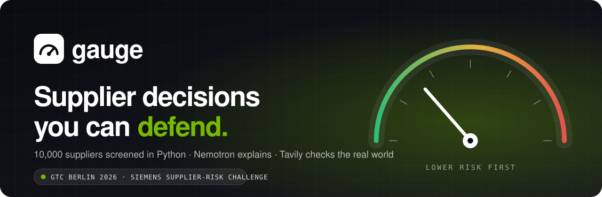
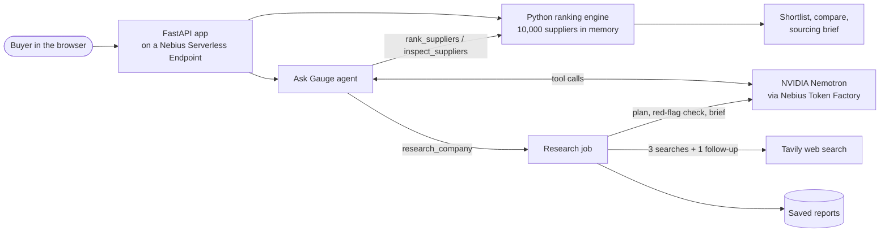

<p align="center">
  
</p>

<p align="center">
  <a href="https://port8000-h1b0vwacrc38sp4.tunnel.applications.uk-south2.nebius.cloud"></a>
  <a href="#run-it-locally"></a>
</p>

<p align="center">
  
  
  
  
  
  
  
</p>

<p align="center">
  <b>Gauge turns a 10,000-row supplier risk dataset into a shortlist a buyer can defend in a meeting,</b><br>
  then checks the real world before anyone signs.
</p>

---

## The problem

Procurement teams sit on large supplier risk datasets and still pick suppliers from gut feeling and spreadsheets. The scores exist, but nobody can say in one sentence *why* supplier A beats supplier B, what changes if A drops out tomorrow, or what the news says about the real company behind a name. LLM chatbots make this worse when they invent numbers.

## What Gauge does

| | |
|---|---|
| 🎯 **Shortlist in one click** | Describe the purchase, pick a priority (quality first, balanced or financial resilience) and a risk ceiling. Python screens and ranks all 10,000 suppliers and shows the top 20 with a transparent buyer score. |
| ⚖️ **Tradeoffs made visible** | Put up to 20 suppliers side by side across all 18 original risk scores plus delivery facts: order volume, delivery rating, confirmation rate and change rate. |
| 🧠 **Ask Gauge (Nemotron agent)** | NVIDIA Nemotron chooses among bounded tools (`rank_suppliers`, `inspect_suppliers`, `research_company`), runs them, updates the screen and explains the result. Every tool call is shown under the answer. |
| 🔁 **"What if this supplier is unavailable?"** | Mark any supplier unavailable and the whole pool is re-ranked instantly. Excluded suppliers stay listed and can be restored. |
| 🌍 **Live company research** | For a real company, Nemotron plans three web searches, Tavily runs them, Nemotron decides whether a red flag needs a follow-up search, then writes a cited brief with clickable sources. |
| 📄 **Sourcing brief export** | One Markdown document with the selection, funnel, scoring method, shortlist, evidence, Nemotron's explanations, web research and the checks still outstanding. |

## Why judges can trust the output

> **The model never computes a score.** Python does all filtering, weighting and ranking. Nemotron only picks tools and explains their results.

- **Nothing is simulated.** When a provider fails, Gauge shows the real error. No canned answers, no fake progress.
- **Unknown stays unknown.** Missing or out-of-range scores are never treated as zero risk, and rows without required scores are reported as unrankable.
- **Honest about the data.** The dataset has no capability, location, price or lead-time columns, so Gauge never claims them and says so on every shortlist.
- **Anonymized suppliers stay anonymous.** Dataset names are never mapped to real companies. Web research is a separate evidence trail and never changes a score.
- **Bounded agent.** At most 5 model rounds, 4 tool calls per round and 120 seconds per question. The model sees a compact shortlist, never the full dataset.

## Built with the hackathon stack

<table>
  <tr>
    <td align="center" width="25%"><br><sub><code>nvidia/Nemotron-3.5-Super-VL</code><br>tool calling, reasoning, cited briefs</sub></td>
    <td align="center" width="25%"><br><sub>hosted Nemotron inference<br>via the OpenAI-compatible API</sub></td>
    <td align="center" width="25%"><br><sub>CPU Serverless Endpoint, Container<br>Registry, MysteryBox secrets</sub></td>
    <td align="center" width="25%"><br><sub>live web search for<br>company due diligence</sub></td>
  </tr>
</table>

No GPU to manage and no frontend build step: one FastAPI process serves the API and a vanilla HTML/CSS/JS frontend, and the model runs on Token Factory.

## How it works



**Research pipeline:** Nemotron plans three searches → Tavily retrieves sources → Nemotron checks the evidence for red flags and decides whether one follow-up search is needed → Nemotron writes a cited brief. Every step on screen is a real request, and completed reports persist across restarts.

### The buyer score

The dataset's own Total Risk Index (TRI) does not publish its weights, so Gauge adds an explicit, app-defined buyer score next to it. All scores are risk scores where **lower is better**.

| Priority | Quality | Operations | Financial risk |
|---|---:|---:|---:|
| Quality first | 50% | 30% | 20% |
| Balanced | 1/3 | 1/3 | 1/3 |
| Financial resilience | 20% | 20% | 60% |

## Two-minute demo

1. Open the [live demo](https://port8000-h1b0vwacrc38sp4.tunnel.applications.uk-south2.nebius.cloud). The header shows 10,000 suppliers loaded and Nemotron and Tavily connected.
2. Type the part you are sourcing, keep *Quality first* and press **Build shortlist**. Read the funnel and the capability caveat.
3. Add #1 and #2 to Compare, open the comparison and press **Explain this tradeoff with Nemotron**.
4. Switch to *Financial resilience*: the table and recommendation recalculate instantly.
5. Press **What if this supplier is unavailable?** The leader drops out and the full pool is re-ranked.
6. Ask Gauge "Why does #1 rank above #2?" and show the tool trace under the answer.
7. Open Company research, name a real supplier and follow the plan, the red-flag decision and the clickable sources (a run takes under a minute, so start one before presenting).
8. Press **Export sourcing brief**.

## Run it locally

Python 3.12 or newer.

```bash
python3.12 -m venv .venv && source .venv/bin/activate
pip install -r requirements.txt
cp env.example .env        # then fill in the keys below
python run.py              # http://localhost:8000
```

In `.env`, set `NEBIUS_API_KEY` (a Token Factory API key, not the Cloud login), `TAVILY_API_KEY`, and either `APP_PASSWORD` (login user `jury`) or `APP_AUTH=off`. Blank values and `__SET_ME__` placeholders count as unconfigured. Never commit `.env`, and restart after editing it.

The organizer dataset `data/supplier_risk_dataset.csv` loads automatically (`SUPPLIER_CSV=sample` starts with a three-row sample instead). Ranking, comparison, exclusion and the brief work without any keys; chat and research say plainly when a key is missing. **Test connections** in the app sends one small live request to each provider.

<details>
<summary><b>Team setup: pull secrets from Nebius MysteryBox</b></summary>

`.env` is never committed. The shared source of truth is the MysteryBox secret `gauge-secrets` in `group50-project`, readable by every project editor.

```bash
git clone git@github.com:ohMySol/kebab-ai-hackathon-project.git && cd kebab-ai-hackathon-project
python3.12 -m venv .venv && source .venv/bin/activate && pip install -r requirements.txt
curl -sSL https://artifacts.nebius.cloud/cli/install.sh | bash          # Nebius CLI, once
~/.nebius/bin/nebius profile create hackathon --parent-id project-e05pcx4nln00sb3fae3bgx   # browser login
deploy/pull-env.sh                                                        # writes .env from gauge-secrets
python run.py
```

Without CLI access, open the console: group50-project → SecretStash → `gauge-secrets` → current version, and copy the three values into a `.env` made from `env.example`. After rotating a key, update the secret (`deploy/nebius-deploy.sh secrets` reads the new `.env`), redeploy, and have every teammate rerun `pull-env.sh`.
</details>

<details>
<summary><b>Docker</b></summary>

```bash
docker build -t gauge .
docker run --rm -p 127.0.0.1:8000:8000 --env-file .env gauge
```

The image bundles the organizer CSV, runs as a non-root user, exposes port 8000 and has a `/healthz` health check. `.env` is excluded by `.dockerignore`.
</details>

<details>
<summary><b>Deploy on Nebius AI Cloud</b></summary>

One CPU-only Serverless Endpoint in the hackathon project (`uk-south2`), the image in the project's Container Registry, secrets from MysteryBox. Nemotron runs on Token Factory, so no GPU is used. `deploy/nebius-deploy.sh` wraps every step (`preflight`, `registry`, `build`, `secrets`, `dry-run`, `create`, `status`, `smoke`, `logs`); see [docs/deployment.md](docs/deployment.md).
</details>

<details>
<summary><b>Data rules</b></summary>

- Required columns: `supplierID`, `Supplier Name`, `Total_Risk_Index`, `Quality_Risk_Score`, `Operational_Resilience_Score`, `Financial_Health_Score`. Every other `*_Score` column appears in details and comparison; `*_Level` columns are kept as supplied.
- Every `_Score` is a risk score from 0 (lowest risk) to 100 (highest), including Financial_Health_Score and Operational_Resilience_Score.
- Missing, non-numeric or out-of-range scores stay unknown. Rows missing a required score are reported as unrankable, never ranked as zero risk. Rows without a valid TRI cannot pass a TRI screen.
- Buyers can narrow the pool to known candidate IDs, because the dataset does not say who makes which component.
- CSV import: up to 20 MB and 50,000 rows with unique IDs. A rejected upload leaves the previous dataset in place.
</details>

## Tests

```bash
.venv/bin/python -m unittest discover -s tests -v    # backend tests, provider calls mocked
node --check web/assets/app.js
```

Browser checks (Playwright, Chromium, 1440 px and 390 px) covered ranking, profile switch, exclusion, comparison, details, research and chat gating, the risk slider, candidate scope and the brief download. [IMPLEMENTATION_STATUS.md](IMPLEMENTATION_STATUS.md) records what was verified live, and [docs/architecture.md](docs/architecture.md) has the full design and limits.

## Accounts used

- **Nebius AI Cloud**: the assigned `groupNN-project` in `uk-south2`, no personal tenant or billing.
- **Nebius Token Factory**: a separate account and API key. Model `nvidia/Nemotron-3.5-Super-VL` (function calling, $0.30 / $0.90 per million input / output tokens, checked in the public catalog on 18 Oct 2026).
- **Tavily**: a separate account and API key.

Official participant guide: https://github.com/dariolaportanebius/nebius-starter-skill/blob/hackathon-participant-guide/README.md

<p align="center"><sub>Built in Berlin for the GTC 2026 hackathon · Siemens supplier-risk challenge</sub></p>
